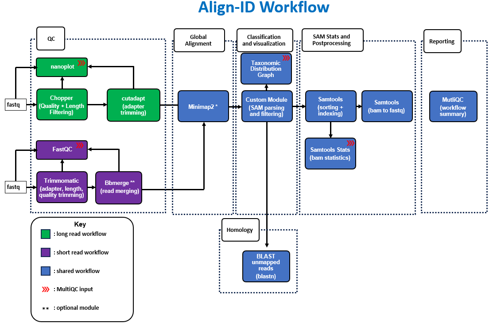
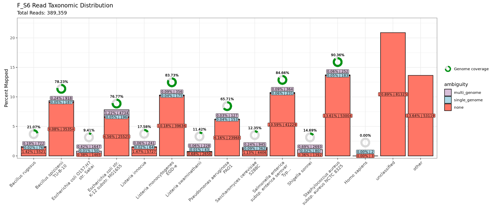

## Align-ID Workflow Diagram


## Summary

**Align-ID** is a SQL optimized, metagenomic classification workflow that utilizes a competative-alignment approach to assign taxonomy to Oxford Nanopore and Illumina sequencing reads. This workflow houses two separate analysis pipelines for long read and short read data sets:

**Long Read ID**
1. _OPTIONAL_: Subsampling ([`BBMap`](https://github.com/BioInfoTools/BBMap))

2. Long read QC: 
     - Read Statistics/Summary ([`Nanoplot`](https://github.com/wdecoster/NanoPlot))
     - _OPTIONAL_: Adapter trimming ([`Porechop`](https://github.com/rrwick/Porechop))
     - Quality and Length Filtering ([`Chopper`](https://github.com/wdecoster/chopper))

3. Read Alignment ([`minimap2`](https://github.com/lh3/minimap2))

4. Read Alignment-based Classification (custom modules plus [`samtools`](https://www.htslib.org/doc/samtools.html))

     - _OPTIONAL_: alignment filtering by taxonomic ID (custom module)
     - _OPTIONAL_: alignment filtering by mapping quality (custom module)

5. Read Taxonomic Distribution Graph (custom module)

6. Alignment Statistics and Post-processing ([`samtools`](https://www.htslib.org/doc/samtools.html))

7. Workflow Summary ([`MultiQC`](https://github.com/MultiQC/MultiQC))


**Short Read ID**
1. _OPTIONAL_: Subsampling ([`BBMap`](https://github.com/BioInfoTools/BBMap))

2. Short read QC:     
     - Read QC ([`FastQC`](https://www.bioinformatics.babraham.ac.uk/projects/fastqc/))
     - Adapter Trimming, Quality Filtering, and Length Filtering ([`trimmomatic`](http://www.usadellab.org/cms/?page=trimmomatic) or [`fastp`](https://github.com/OpenGene/fastp))
     - _OPTIONAL_: Read Merging ([`BBMap`](https://github.com/BioInfoTools/BBMap))

3. Read Alignment ([`minimap2`](https://github.com/lh3/minimap2))

4. Read Alignment-based Classification (custom modules plus [`samtools`](https://www.htslib.org/doc/samtools.html))

     - _OPTIONAL_: alignment filtering by taxonomic ID (custom module)
     - _OPTIONAL_: alignment filtering by mapping quality (custom module)

5. Read Taxonomic Distribution Graph (custom module)

6. Alignment Statistics and Post-processing ([`samtools`](https://www.htslib.org/doc/samtools.html))

7. Workflow Summary ([`MultiQC`](https://github.com/MultiQC/MultiQC))


## Installation

1. Clone repository:

```bash
git clone https://github.com/srusher/Align-ID
```

2. Install and activate nextflow via Conda:

```bash
conda create --name nf-env bioconda::nextflow
source activate nf-env
```

3. Install Singularity: See singularity docs for installation guide (https://docs.sylabs.io/guides/3.0/user-guide/installation.html#install-on-linux)

4. Singularity containers used in this workflow are pulled from https://depot.galaxyproject.org/singularity/; ensure you have a stable internet connection. These containers generally only need to be pulled once as singularity will cache them for future use

## Setup

First, prepare a samplesheet with your input fastq data that adheres to the following format:

**Automatically Format Samplesheet**

The helper script, `./bin/format_samplesheet.sh`, can be used to automatically format your long and short read samplesheets. Usage below:

```bash
bash ./bin/format_samplesheet.sh <path/to/fastq_dir> <delimiter> <read_type> <single_end> <path/to/samplesheet> 
```

Example Usage:

```bash
bash ./bin/format_samplesheet.sh data/short-read/fastq '_' 'short' 'false' 'assets/short-read/samplesheets/samplesheet.csv 
```

The `delimiter` parameter should be the first character that follows the last letter of your desired prefix. For example, if I have a fastq file named: `ML1_0819-01_trimmed_R1` and I want the prefix for to be `ML1` then I would set to delimiter to `_` character

**Long Read Samplesheet: Manual Formatting**

`assets\long-read\samplesheet.csv`:

```csv
sample,fastq_long
SAMPLE_1,/scicomp/groups-pure/WDPB/EMEL/long-reads/sample1-long-read-ont.fastq.gz
SAMPLE_2,/scicomp/groups-pure/WDPB/EMEL/long-reads/sample2-long-read-ont.fastq.gz
```

The top row is the header row ("sample,fastq_long") and should never be altered. Each row below the header, represents a fastq file with a unique identifier in the "sample" column (SAMPLE_1 and SAMPLE_2 in the example above). Each fastq file needs to be gzipped/compressed to prevent validation errors from occuring at the initialization of the pipeline

There is an example samplesheet located under the assets folder (`assets/long-read/samplesheet.csv`) that you can view and edit yourself. **NOTE** If you use this samplesheet, please make a back up copy of it as it will be overwritten each time you pull an updated version of this repository. 

**Short Read Samplesheet: Manual Formatting**

Paired Reads `assets\short-read\samplesheet_paired.csv`:

```csv
sample,fastq_1,fastq_2
SAMPLE_1,/data/reads/sample1-R1.fastq.gz,data/reads/sample1-R2.fastq.gz
SAMPLE_2,/data/reads/sample2-R1.fastq.gz,data/reads/sample2-R2.fastq.gz
```

Single End or Merged Reads `assets\short-read\samplesheet_merged.csv`:

```csv
sample,fastq_1,fastq_2
SAMPLE_1,/data/reads/sample1-R1.fastq.gz,
SAMPLE_2,/data/reads/sample2-R1.fastq.gz,
```

Notice how the short read samplesheets have 3 header columns `sample,fastq_1,fastq_2`. Just as with the long reads, never change these headers. The fastq_1 and fastq_2 columns are where you specify the forward and reverse paired reads respectively. If you are using single end reads or merged reads then you will only input one fastq file but DO NOT DELETE THE SECOND COMMA in the sample entry row (reference the samplesheet_merged example above)

**Reference Genome and Index**

Align-ID needs a single FASTA file or minimap index of the entire set of reference fastas you intend to map your reads to. Regardless of whether you intend to use an index or a FASTA, you'll want to first concatenate all reference genomes into a single file:

```bash
cat ref_genome_1.fasta ref_genome_2.fasta > all_ref_genomes.fasta
```

If you a have an incredibly large reference data set, you'll want to index it first to cut down on runtime (otherwise the workflow will generate the index for every sample set, every time it's ran). For smaller reference genomes, the indexing step is trivial and can be skipped if desired. Insert the file path to your combined fasta into this minimap2 command (minimap2 singularity container included in command):

Long Read Format:
```bash
singularity exec https://depot.galaxyproject.org/singularity/minimap2%3A2.28--he4a0461_1 minimap2 -x map-ont -I 40G -d all_ref_genomes.mmi all_ref_genomes.fasta
```

Short Read Format:
```bash
singularity exec https://depot.galaxyproject.org/singularity/minimap2%3A2.28--he4a0461_1 minimap2 -x sr -I 40G -d all_ref_genomes.mmi all_ref_genomes.fasta
```

IMPORTANT: the `-I` flag needs to be set to a size 5GB larger than the reference fasta. So in the above examples, the input fastas were about 35GB in size. Setting `-I` to plus 5GB of the reference size ensures that the index is not split into a multi-part index - which can greatly affect MAPQ.

Note that the `-d` flag with a `.mmi` file extension represents the output index file path.

Once you've got your reference FASTA or index setup, go into your configuration file(s) and update the `minimap2_genome_reference` parameter with the file path to your `.fasta` or `.mmi` file.

**Taxonomy Assets**

Align-ID utilizes taxonomy assets found on NCBI's FTP server (https://ftp.ncbi.nlm.nih.gov/pub/taxonomy/). The helper script `./bin/fetch_taxonomy.sh` will retrieve all necessary files and drop them into the `./assets/taxonomy/` directory. To run the script, use the following command (this requires a stable internet connection):

```bash
bash ./bin/fetch_taxonomy.sh
```

OPTIONAL: When dealing with metagenomic datasets, strain level classifications can often result in noisy taxonomic profiles. To denoise the results, we can replace all strain level and below taxonomic IDs with their parent species taxonomic ID in the `seqid2taxid.map` mapping file and compile them into a separate database using the following command:

```bash
bash ./bin/fetch_taxonomy.sh no-strain
```

NOTE: There's a lot of data being retrieved and processed during this step, so it may take around 60 minutes from start to finish.

If the script runs correctly, there should be 5 files (6 if you run the script with the `no-strain` parameter) in the `./assets/taxonomy/` directory:

```
names.dmp
names_other.dmp
names_scientific.dmp
nodes.dmp
seqid2taxid.map
seqid2taxid_no-strain.map
```

When a read maps to a reference sequence, the algorithm uses the `seqid2taxid.map` file to look up the tax ID associated with that reference sequence. The `tax_map` table is formatted with the `sequence ID` in the first column and the `tax ID` in the second column:

```tsv
AP025345	5098
AP028243	3040995
CP099429	215465
CP119914	1381934
```

This is just a snippet of the mapping file. The full mapping file is converted to a SQL database, assigned to the `seqid2taxid_map` variable in the configuration file(s), and contains all reference GenBank accessions and their respective tax IDs.

**Custom Reference Genomes and Taxonomy**

If you are using reference genomes / accession IDs that are not in RefSeq, you will need to manually add the sequence/accession IDs to the taxonomy map. There is a helper script `./bin/add_fasta_to_seq_map.sh` that can assist you in adding reference fastas (each belonging to a single tax ID) into the taxonomy map. This means that the contig / sequence name will be stored as the sequence ID and the taxonomic ID you provide will be stored as the tax ID. The script expects a file path to a text document where each line is formatted with the path to the fasta file, a pipe '|' character, and the tax ID:

```tsv
path/to/my_fasta_1|123456
path/to/my_fasta_2|654321
```

Running the helper script itself looks like this:

```bash
bash ./bin/add_fasta_to_seq_map.sh '/path/to/fasta_list_file'
```

NOTE: This step needs to be performed on individual fasta files. Do not run this script on a concatentated fasta unless each individual contig originated from the same species / Tax ID

**Config File Setup**

The configuration files for the long read and short read workflows can be found in `./conf/long-read.conf` and `./conf/short-read.conf` respectively.

Open the config file(s) and make the appropriate adjustments to each parameters. Of note, the `input` parameter should be set to the path of your samplesheet and the `outdir` parameter should be set to a new directory for each iteration - otherwise you risk overwriting the results of previous runs.

Other important parameters:
`minimap2_genome_reference`: should be set to the `.mmi` index file you generated during setup - can also be a (relatively) small fasta file
`ref_fasta`: fasta file used to build to minimap2 index - if you opted not to build the index, then this path should be the identical to the previous param
`my_tax_ids`: only applicable when `skip_filter_alignment_by_id` is set to `false` - see (Filtering Taxonomic ID section below)

**Filtering Taxonomic ID**

If you're only interested in the classifications of a particular taxonomy then set the parameter `skip_filter_alignment_by_id` to `false` and enter the tax ID(s) of interest into a text file, each separated by a new line. Then set the `my_tax_ids` parameter to the path of the file containing your tax IDs. To include all child taxonomies of the provided tax IDs, set the `include_children` parameter to `true`. For example, if you want to filter for Enterobacterales (family) and all of its child taxonomies (genus, species, and strain), you would enter tax ID `543` into your `my_tax_ids` file and set `include_children` to `true`.


## Usage

Once the samplesheet has been formatted and the configuration files have been modified, load up nextflow into your environment with:

`ml nextflow`

Now we can run the workflow using one of the 2 methods listed below.

**Method 1: Cluster Submission**:

This method allows you to submit each workflow task to SciComp's cluster computing nodes for enhanced processing speeds and workload parallelization. This is a good "fire and forget" method for new users who aren't as familiar with SciComp's compute environment

Long Read Format:
```bash
nextflow run main.nf -profile singularity,scicomp_rosalind,short
```

Short Read Format:
```bash
nextflow run main.nf -profile singularity,scicomp_rosalind,long
```


**Method 2: Local Execution**:

Best for pipeline testing and QC. Also useful for troubleshooting if the cluster submission method is giving you issues **NOTE: This workflow has the potential to utilize hundreds of GBs worth of RAM - ensure your server has sufficient resources available**:
 
Long Read Format:
```bash
nextflow run main.nf -profile singularity,local,long
```

Short Read Format:
```bash
nextflow run main.nf -profile singularity,local,short
```


## Output

All results will be sent to the `./results` directory unless otherwise stated using the `--outdir` parameter. The outputs of various tools can be found under their respective names (i.e. the FastQC results can be found under `./results/fastqc`). 

The unique outputs from this workflow can be found under the `taxonomy_reports` directory. These outputs will summarize the taxonomic distribution of the sample in both text-based and graphical format.

Text-based Format:

```tsv
species	species_read_count	species_read_perc	ambigutiy_none_read_count	ambiguity_none_percent	ambigutiy_single_read_count	ambiguity_single_percent	ambigutiy_multi_read_count	ambiguity_multi_percent	genome_cov(%)	mean_depth	genome_len	n_contigs	mean_mapq
unclassified	81325	20.887%	81325	20.886894%	0	0%	0	0%	NA%	NA	NA	NA	NA
Staphylococcus aureus subsp. aureus NCTC 8325	53439	13.725%	53004	13.613144%	183	0.047%	252	0.064722%	90.36181474118342%	6.227040000000001	2821361	1	57.6
Salmonella enterica subsp. enterica serovar Typhimurium str. LT2	41824	10.741%	41229	10.588942%	231	0.059328%	364	0.093487%	84.65675145711815%	2.700377508508229	4951383	2	58.0893642305407
Listeria monocytogenes EGD-e	40167	10.316%	39636	10.179808%	175	0.044946%	356	0.091432%	83.72815609157054%	4.47821	2944528	1	50.0
Bacillus spizizenii TU-B-10	36459	9.364%	35354	9.080052%	187	0.048028%	918	0.235772%	78.22772366183672%	2.85846	4207222	1	46.3
Escherichia coli str. K-12 substr. MG1655	30455	7.822%	25525	6.555647%	196	0.050339%	4734	1.215845%	76.77473451262611%	2.1691	4641652	1	34.7
Pseudomonas aeruginosa PAO1	24248	6.228%	23968	6.155759%	153	0.039295%	127	0.032618%	65.71479106392245%	1.1759	6264404	1	57.5
Bacillus rugosus	6319	1.623%	5521	1.417972%	76	0.019519%	722	0.185433%	21.069328743279982%	0.473743	4146938	1	29.0
Listeria innocua	6032	1.549%	5727	1.470879%	64	0.016437%	241	0.061897%	17.57573553478561%	0.6642577277231628	2887185	2	41.73440633245383
Saccharomyces cerevisiae S288C	5713	1.468%	4406	1.131603%	362	0.092973%	945	0.242707%	12.353911560359148%	0.15305436096836375	12157105	17	37.63467241379311
Shigella sonnei	4165	1.071%	1392	0.357511%	80	0.020547%	2693	0.69165%	14.692608191307931%	0.2571841903155406	4994001	2	10.3
Escherichia coli O157:H7 str. Sakai	3162	0.812%	1465	0.376259%	50	0.012842%	1647	0.423003%	9.407938540790637%	0.16999771579904388	5594605	3	17.296184863523575
```

Graphical Format:


In the bar plot above, each species is subdivided into 3 different ambiguity groups. The red portion represents unambiguous read mappings, blue corresponds to ambiguously aligned reads within a single genome, and purple indicates ambiguous alignments across multiple genomes. All data labels contain the percentage of reads (out of all reads) and number of reads associated with a particular species and ambiguity group The bar plot can depict up to 20 different species. All classifications made after the 20th species will be grouped into a 'other' species.

For additional details on how ambiguity is determine along with examples, please read [docs/ambiguity_examples.md](docs/ambiguity_examples.md)


## Parameters

Parameters for the long read and short read analysis pipelines are located in `./conf/long-read.conf` and `./conf/short-read.conf` respectively. You can manually change these parameters via a text editor or you can pass in the individual parameters via the command line (see the Usage section above for command line parameter formatting and syntax). See below for all possible input parameters:


**Shared Parameters**:
| Parameter | Data Type | Default Value |
|:---------:|:---------:|:-------------:|
| `--memory_saver` | boolean | false |
| `--skip_subsample` | boolean | true |
| `--skip_trimming` | boolean | false |
| `--skip_blast_unmapped` | boolean | true |
| `--skip_filter_alignment_by_id` | boolean | true |
| **BBmap Parameters**|            |            |
| `--num_subsamples` | integer | 1000 |
| **Minimap2 Parameters** |            |            |
| `--minimap2_meta` | string | "all-genomes" |
| `--split_prefix` | boolean | false |
| **Taxonomic ID Filtering Parameter** |            |            |
| `--my_tax_ids` | path | "<null>" |
| **Alignment Classification Parameters** |            |            |
| `--seqid2taxid_map` | path | "./assets/taxonomy/tax_map.db" |
| `--filter_alignment_by_id` | boolean | false |
| `--ncbi_taxonomy_nodes` | path | "./assets/taxonomy/nodes.dmp" |
| `--ncbi_taxonomy_names` | path | "./assets/taxonomy/names.dmp" |
| `--local_nodes_db` | path | "./assets/taxonomy/parent_child_nodes.db" |
| `--mapping_quality` | integer | 0 |
| **BLAST Parameters** |            |            |
| `--blast_db` | path | "/scicomp/groups-pure/WDPB/EMEL/Projects/Long_Read_Analysis_RUSHER/data/blast/arch-bact-fung-hum-amoeba_refseq/arch-bact-fung-hum-amoeba_refseq" |
| `--blast_evalue` | string | "1e-10" |
| `--blast_perc_identity` | string | "90" |
| `--blast_target_seqs` | string | "5" |


**Long Read Specific Parameters**:
| Parameter | Data Type | Default Value |
|:---------:|:---------:|:-------------:|
| `--skip_cutadapt` | boolean | true |
| **CutAdapt Parameters** |            |            |
| `--cutadapt_adapter_fasta` | path | "./assets/long-read/adapters/ATL-gene-adapters_cutadapt.fasta" |
| **Chopper Parameters** |            |            |
| `--chopper_q` | integer | 20 |
| `--chopper_min_len` | integer | 1000 |
| `--chopper_max_len` | integer | 2147483647 |
| **Minimap2 Parameters** |            |            |
| `--minimap2_genome_reference` | path | '/scicomp/groups-pure/WDPB/EMEL/Projects/Long_Read_Analysis_RUSHER/data/minimap2/index/long-read/ATL_gene.mmi' |
| `--minimap2_mismatch_penalty` | integer | 4 |


**Short Read Specific Parameters**:
| Parameter | Data Type | Default Value |
|:---------:|:---------:|:-------------:|
| `--skip_merging` | boolean | true |
| **Trimming Parameters** |            |            |
| `--trim_tool` | string | "trimmomatic" |
| `--adapt_ref` | path | "./assets/short-read/sequencing-adapters.fasta" |
| **Trimmomatic Parameters** |            |            |
| `--trimmomatic_params` | string | "ILLUMINACLIP:./assets/short-read/sequencing-adapters.fasta:2:30:10 SLIDINGWINDOW:4:20 MINLEN:50" |
| **FASTP Parameters** |            |            |
| `--fastp_params` | string | "" |
| `--adapter_auto_detect` | boolean | false |
| **Minimap2 Parameters** |            |            |
| `--minimap2_genome_reference` | string | '/scicomp/groups-pure/WDPB/EMEL/Projects/Long_Read_Analysis_RUSHER/data/minimap2/index/short-read/ZYMO.mmi' |
| `--minimap2_mismatch_penalty` | integer | 8 |


## Credits

Align-ID was originally written by Sam Rusher (rtq0@cdc.gov).

## Citations

This pipeline uses code and infrastructure developed and maintained by the [nf-core](https://nf-co.re) community, reused here under the [MIT license](https://github.com/nf-core/tools/blob/master/LICENSE).

> **The nf-core framework for community-curated bioinformatics pipelines.**
>
> Philip Ewels, Alexander Peltzer, Sven Fillinger, Harshil Patel, Johannes Alneberg, Andreas Wilm, Maxime Ulysse Garcia, Paolo Di Tommaso & Sven Nahnsen.
>
> _Nat Biotechnol._ 2020 Feb 13. doi: [10.1038/s41587-020-0439-x](https://dx.doi.org/10.1038/s41587-020-0439-x).

## SHARE IT Act Metadata

Organization: CDC/NCEZID/DFWED/WDPB

Contact email: ncezid_shareit@cdc.gov,  rtq0@cdc.gov

Contract#: 

Description: Align-ID is a bioinformatics workflow designed to generate taxonomic profiles from environmental samples sequenced by Oxford Nanopore and Illumina instruments using a competitive alignment approach.

Languages: Python, R, SQL, Other

Exemption: 

Exemption Justification: 
